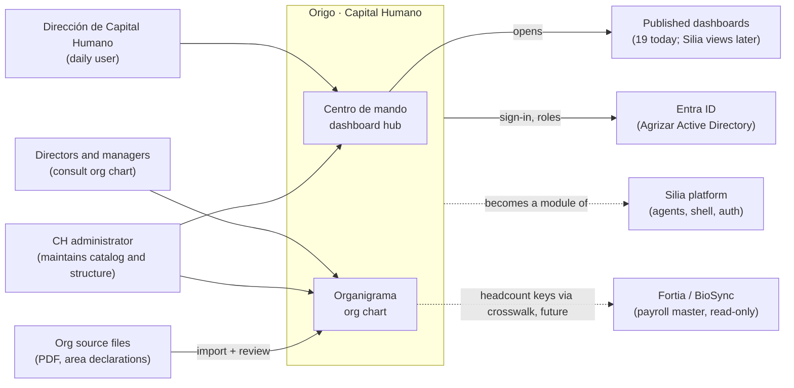
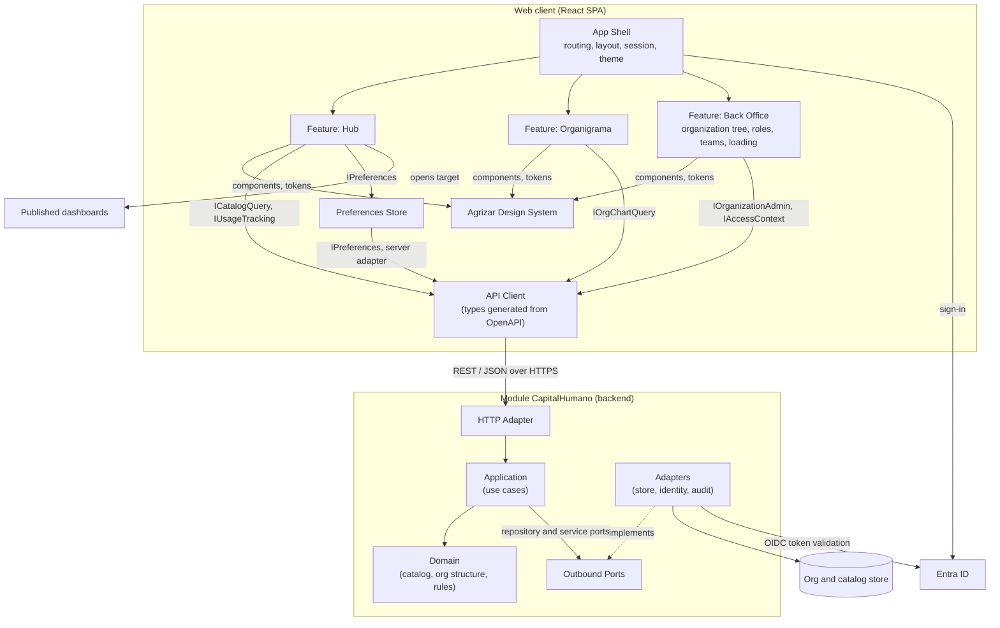
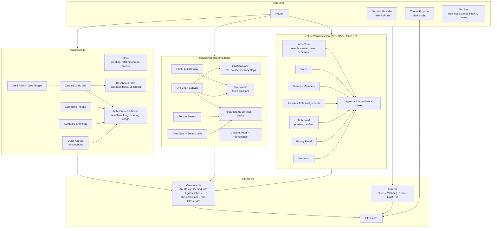
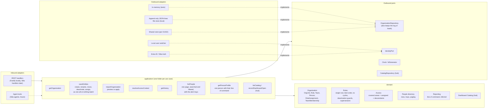
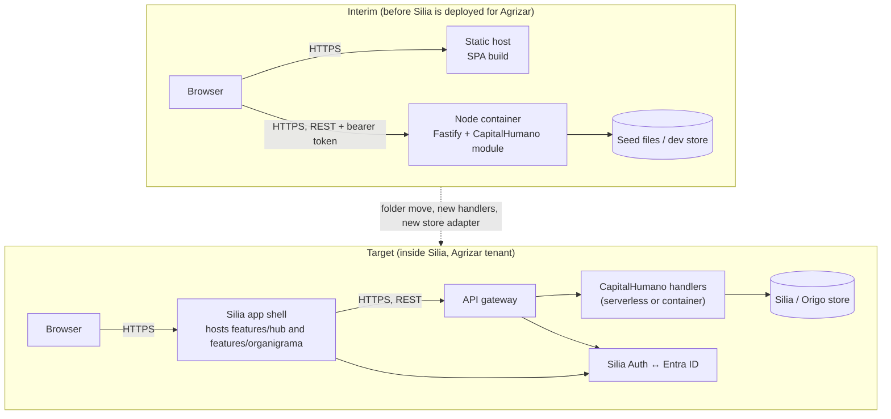
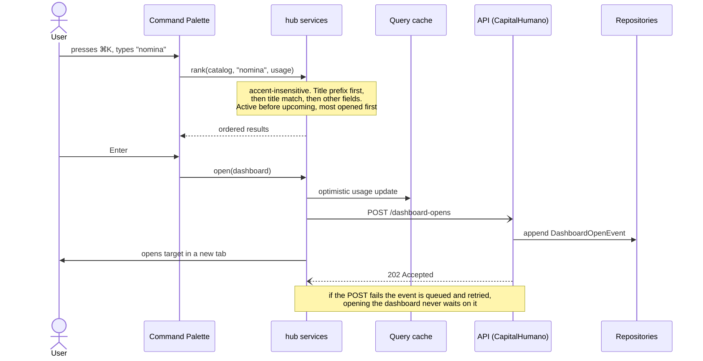
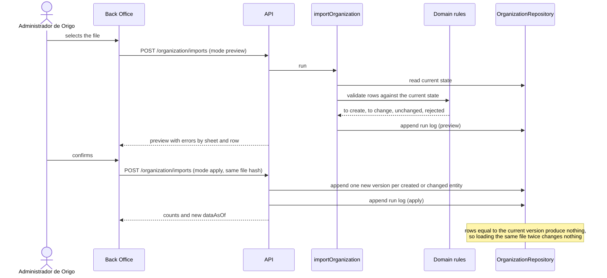
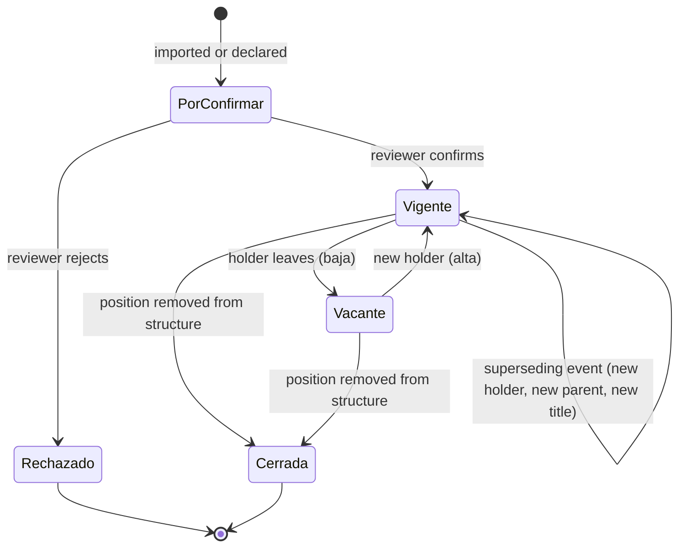
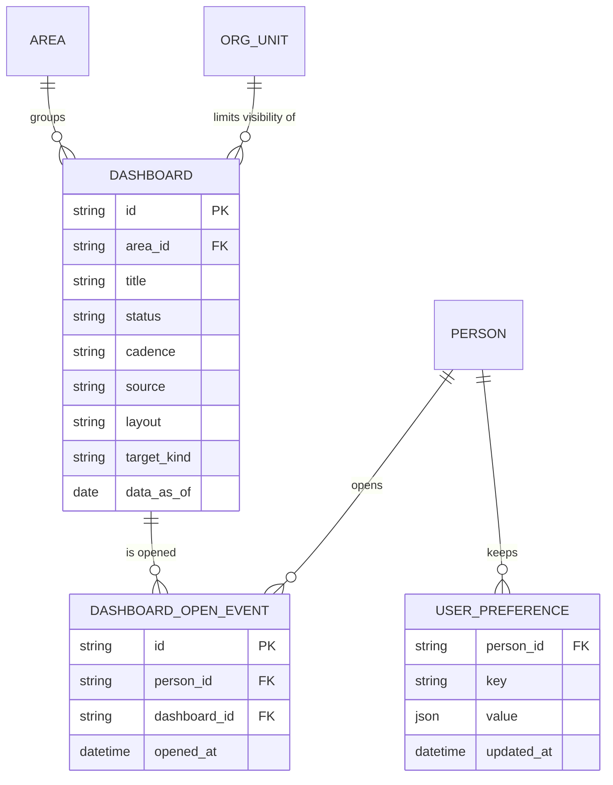

# Component diagrams

Architecture description of Origo · Capital Humano (Centro de mando +
Organigrama), organized the way SWEBOK asks a design to be recorded.

## How this follows SWEBOK

SWEBOK (Guide to the Software Engineering Body of Knowledge, v4; the Software
Architecture and Software Design knowledge areas) asks for a design to be
described through several **views**, each answering one stakeholder concern,
using **structural** (static) and **behavioral** (dynamic) descriptions.

| SWEBOK element | Where it is in this document |
|---|---|
| Architecture views and viewpoints (ISO/IEC/IEEE 42010) | §1 context, §2–§4 logical, §5 deployment, §6 behavior, §7 data |
| Structural description: component diagram | §2, §3, §4 |
| Structural description: deployment diagram | §5 |
| Structural description: entity-relationship diagram | §7 |
| Behavioral description: sequence diagram | §6.1, §6.2 |
| Behavioral description: state diagram | §6.3 |
| Design principles (abstraction, coupling and cohesion, decomposition and modularization, encapsulation, separation of interface and implementation, separation of concerns) | §8 |
| Key design issues (concurrency, events, persistence, distribution, error handling, interaction and presentation, security) | §9 |
| Design rationale | `../adr/ADR-0001-technology-stack.md` |

Component diagram convention: a box is a component; a labelled arrow
`A -->|interface| B` means **A requires an interface that B provides**.

## 1. Context view

Who and what the system talks to.

## 2. Logical view: top-level components

### Provided and required interfaces

| Component | Provides | Requires |
|---|---|---|
| Feature: Hub | Hub screen, command palette | `ICatalogQuery`, `IUsageTracking`, `IPreferences`, DS components |
| Feature: Organigrama | Org chart screens, person search, print view | `IOrgChartQuery`, DS components |
| Feature: Back Office | Organization tree, roles, teams, people, bulk load, history, "Ver como" | `IOrganizationAdmin`, `IOrganizationQuery`, `IAccessContext` |
| Agrizar Design System | Tokens, primitives, ambient effects | nothing (leaf) |
| Preferences Store | `IPreferences` (order, view, theme) | browser storage now, API later |
| API Client | Typed calls for every backend interface | HTTP, access token from the shell |
| HTTP Adapter | REST endpoints, OpenAPI document | use cases, `IdentityPort` |
| Application | `IOrganizationQuery`, `IOrganizationAdmin`, `IAccessContext`, `ICatalogQuery`, `IUsageTracking`, `IPreferences`, `IOrgChartQuery` | domain, outbound ports |
| Domain | Entities, value objects, rules | nothing (leaf) |
| Adapters | Port implementations | store, Entra ID, clock |

## 3. Logical view: web client decomposition

Rule: components render, hooks hold state, services hold logic and API calls
(Silia's React architecture guideline). Search ranking, card ordering and tree
layout are pure functions with unit tests and no React imports.

## 4. Logical view: backend module (hexagonal)

Dependency rule: arrows point inward. `domain/` imports nothing; `application/`
imports `domain/` and port types; adapters import everything they need and are
the only code that knows a framework, SDK or driver.

`resolveAccessContext` is the interface the neighbouring stories consume: AG-1
(GRZR-30) and MD-5 (GRZR-42) ask it who a person is in the organization.

## 5. Deployment view

Today the app runs outside Silia; the target is to be a Silia module.

## 6. Behavioral view

### 6.1 Open a dashboard from the command palette

### 6.2 Load the organization from a file (GRZR-31, AC2)

### 6.3 Life cycle of a position record (people chart, later)

## 7. Data view

The organization model (areas, roles, teams, people, assignments, memberships)
is specified with its tables, rules and diagram in
[`../spec/data-model-organization.md`](../spec/data-model-organization.md).

The hub adds two small pieces:

Catalog versions and events are append-only. What users see is a current-state
view: for each stable id, the latest row that no other row supersedes.

## 8. Design principles applied

| Principle (SWEBOK) | How it shows up |
|---|---|
| Abstraction | Ports describe what the app needs (a catalog, an identity) without saying how it is supplied |
| Coupling and cohesion | One feature folder per screen family; one use case per folder; features never import each other |
| Decomposition and modularization | Shell / features / design system on the client; inbound / application / domain / outbound on the server |
| Encapsulation and information hiding | Each feature exports one `index.ts`; storage and transport details stay inside adapters |
| Separation of interface and implementation | Zod and OpenAPI contracts are the interface; adapters are replaceable implementations |
| Separation of concerns | Rendering in components, state in hooks, rules in services and domain |
| Sufficiency, completeness, primitiveness | Use cases are small and single-purpose; the admin feature composes them |

## 9. Key design issues

| Issue (SWEBOK) | Decision |
|---|---|
| Concurrency | Position changes are appended, never updated, so two reviewers cannot overwrite each other; a superseding event names the event it replaces and is rejected if that event is already superseded |
| Control and handling of events | UI is event-driven; usage events are fire-and-forget with a retry queue; theme change is broadcast once, not polled |
| Data persistence | Append-only event collections plus current-state views; preferences are per user; storage engine hidden behind repositories |
| Distribution of components | SPA + stateless API; no server session, so the API can run as containers or functions |
| Error and exception handling, fault tolerance | The hub renders from the last cached catalog if the API is down; WebGL failure removes the canvas and leaves the static background; every list has an empty and an error state |
| Interaction and presentation | Keyboard first (⌘K, `/`, digits, `F`); reduced-motion respected everywhere; print view for the org chart; Spanish copy |
| Security | Entra ID sign-in; role and org-scope checks in the application layer; dashboard links served only to authorized users, never bundled in the client; audit log on every write |
