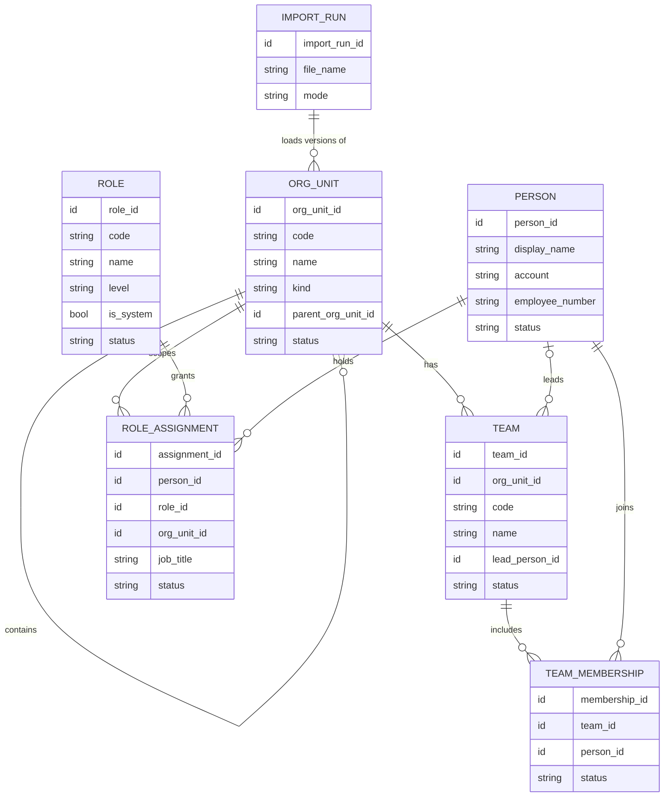

# Data model: organization (MD-2, GRZR-31)

Engine-neutral design, following the Origo data-model conventions
(`origo-data-model` skill): catalogs keep every version, event rows are
INSERT-only, corrections are superseding rows, apps read `v_*_current` views.
The database engine is not chosen here.

## 1. Tables

| Table | Kind | One row is |
|---|---|---|
| `cat_org_unit` | Catalog (versioned) | A version of an área |
| `cat_role` | Catalog (versioned) | A version of a role |
| `cat_team` | Catalog (versioned) | A version of an equipo |
| `cat_person` | Catalog (versioned) | A version of a person |
| `org_role_assignment` | Event | A person given, or losing, a role on an área |
| `org_team_membership` | Event | A person joining or leaving an equipo |
| `org_import_run` | Event (log) | One bulk load, previewed or applied |

### Columns on every row (Origo mandatory set)

| Column | Notes |
|---|---|
| `id` | ULID of this row (this version) |
| `recorded_at` | System time of the insert |
| `effective_at` | Business time the change applies from |
| `actor_id` | Who made the change |
| `source` | `web` or `import:<import_run_id>` |
| `source_ref` | File name and row number for imported rows |
| `supersedes_id` | The row this one replaces; null for the first version |
| `idempotency_key` | Unique; for imports it is the hash of the entity key and its content |
| `legal_entity_id` | Nullable until the legal-entity catalog exists (see Q-3 in the spec) |

### `cat_org_unit`

| Column | Type | Rule |
|---|---|---|
| `org_unit_id` | id | Stable across versions |
| `code` | text | Unique among current rows, e.g. `CH-OPE` |
| `name` | text | Required |
| `kind` | enum | `empresa`, `direccion`, `area`, `subarea` |
| `parent_org_unit_id` | id, nullable | Null only for the single root |
| `site_id` | id, nullable | For áreas tied to one site |
| `sort_order` | int | Order among siblings |
| `status` | enum | `active`, `inactive` |

### `cat_role`

| Column | Type | Rule |
|---|---|---|
| `role_id` | id | Stable across versions |
| `code` | text | Unique among current rows, e.g. `supervisor` |
| `name` | text | Required |
| `description` | text | Optional |
| `level` | enum, nullable | Ladder position; null for roles outside it |
| `is_system` | bool | True for roles the app depends on (Administrador de Origo); cannot be deactivated |
| `status` | enum | `active`, `inactive` |

### `cat_team`

| Column | Type | Rule |
|---|---|---|
| `team_id` | id | Stable across versions |
| `org_unit_id` | id | The one área it belongs to |
| `code` | text | Unique inside its área |
| `name` | text | Required |
| `lead_person_id` | id, nullable | Must be an active member |
| `status` | enum | `active`, `inactive` |

### `cat_person`

| Column | Type | Rule |
|---|---|---|
| `person_id` | id | Stable across versions |
| `display_name` | text | Required |
| `account` | text, nullable | Corporate account (UPN / e-mail); unique when present |
| `employee_number` | text, nullable | Payroll key; maps through a crosswalk later, never by name |
| `status` | enum | `active`, `inactive` |

Personal data. Only invented people are stored in this repo and in DEV.

### `org_role_assignment`

| Column | Type | Rule |
|---|---|---|
| `assignment_id` | id | Stable across versions |
| `person_id` | id | Active person |
| `role_id` | id | Active role |
| `org_unit_id` | id | Scope root: the assignment covers this área and its descendants |
| `job_title` | text, nullable | Free text, e.g. "Gerente de Operación Hidroponía" |
| `status` | enum | `active`, `revoked` |

One active assignment per (person, role, área).

### `org_team_membership`

| Column | Type | Rule |
|---|---|---|
| `membership_id` | id | Stable across versions |
| `team_id` | id | Active equipo |
| `person_id` | id | Active person |
| `status` | enum | `active`, `removed` |

### `org_import_run`

| Column | Type |
|---|---|
| `import_run_id` | id |
| `file_name`, `file_hash` | text |
| `mode` | `preview`, `apply` |
| `created`, `changed`, `unchanged`, `rejected` | int |
| `errors` | list of { sheet, row, code, message } |

## 2. Current-state views

| View | Definition |
|---|---|
| `v_org_unit_current` | Latest non-superseded row per `org_unit_id` |
| `v_role_current`, `v_team_current`, `v_person_current` | Same, per stable id |
| `v_role_assignment_current`, `v_team_membership_current` | Latest row per stable id, status active |
| `v_org_unit_tree` | Current áreas with `depth` and `path` (list of ancestor ids) |
| `v_access_context` | Per person: roles, covered áreas (assigned plus descendants), equipos |

Every API response carries `dataAsOf`: the latest `recorded_at` it read.

## 3. Rules

| ID | Rule | Spec |
|---|---|---|
| R-01 | Exactly one current root; its kind is `empresa`. The root cannot be deactivated | M2-01 |
| R-02 | A child's kind is never higher than its parent's: empresa > direccion > area > subarea. A subárea may hang from a subárea | M2-01. ASSUMPTION: four kinds are enough |
| R-03 | A move is rejected if the new parent is the área itself or one of its descendants. This holds for inactive áreas too: they keep their place in the tree and can still be moved | M2-02 |
| R-04 | Codes are compared trimmed, case-insensitive and accent-insensitive | M2-01, M2-03 |
| R-05 | Deactivating an área requires no active children, equipos or assignments | M2-08 |
| R-06 | Deactivating a role requires no active assignments; system roles cannot be deactivated, and their code never changes, not even in case or accents | M2-08, M2-16 |
| R-07 | Deactivating an equipo requires no active members | M2-08 |
| R-08 | A lead must be an active member of the equipo. A load that names a lead who is not one reports the row and leaves the equipo's lead as it was | M2-04, M2-18 |
| R-09 | An assignment on an área covers that área and every current descendant, at the time of the question | M2-09 |
| R-10 | A change never edits a row: it inserts a new one whose `supersedes_id` is the current row. If that row is no longer current, the write is rejected as a conflict | M2-07 |
| R-11 | A record saved or loaded with content equal to its current version produces no row | M2-15, M2-19 |
| R-12 | Only a person with an active assignment to the system role `administrador_origo` may write. The last such assignment cannot be revoked nor changed to another role | M2-16 |
| R-13 | A load is applied only by confirming its preview: same files, same person, organization unchanged since the preview. The seed is the only direct load | M2-18 |
| R-14 | A code repeated inside one load file is an error on the later row; the first row loads | M2-18 |

## 4. Diagram

## 5. What other stories read from here

| Consumer | Reads |
|---|---|
| AG-1 Gobernanza del dato (GRZR-30) | Roles and who holds them per área, to decide who writes and who approves |
| MD-5 Perfiles y permisos (GRZR-42) | `v_access_context` as the "who" side of the role × view × action matrix |
| Centro de mando | Covered áreas, to decide which dashboards a person sees |
| Organigrama | Áreas, people and job titles; reporting lines are added on top |
